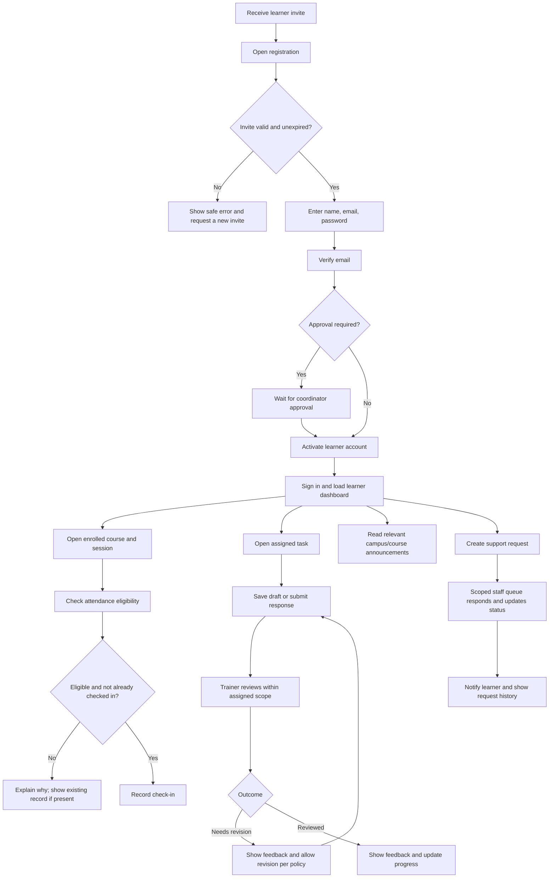
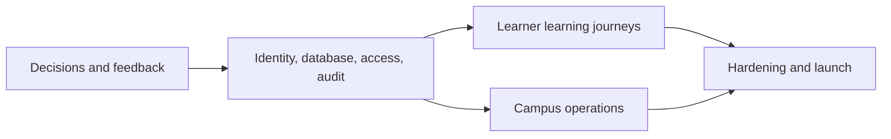

# Zyngram Campus Hub — Day 18 Implementation Blueprint

**Status:** Ready for product and engineering review  
**Scope:** Revised UI design, functional specification, roles and access, end-to-end workflow, production data model, and delivery roadmap  
**Relationship to Day 17:** This is a separate planning deliverable. It does not change the Day 17 prototype or its sample data.

## 1. Purpose and revision basis

Campus Hub brings learning, campus updates, attendance, and help into one role-aware experience. The Day 17 prototype already demonstrates sign-in, courses, tasks and feedback, attendance, announcements, support requests, and four account roles.

No separate Day 17 feedback notes were present in the workspace. Therefore, these are proposed refinements based on gaps visible in the prototype, not claims about feedback that was received:

1. Add an explicit registration and account-verification journey; the prototype currently starts at demo-account sign-in.
2. Give the learner home a clearer priority order: next session, due work, feedback, then campus updates.
3. Make attendance eligibility and duplicate check-in rules visible before confirmation.
4. Distinguish learner, trainer, coordinator, and administrator actions in both navigation and server authorization.
5. Define what happens after a support request is created, instead of leaving it at an open ticket.
6. Specify production-ready storage and testing beyond the prototype's local JSON store.

Product stakeholders should attach and confirm the actual Day 17 feedback before visual sign-off. The screens and rules below are a reviewable baseline.

## 2. Revised UI designs

### 2.1 Shared visual and interaction rules

- Keep the Day 17 visual direction: calm sage/teal foundation, violet and warm accent colors, roomy cards, familiar icons, and the Zyngram brand.
- Use the same responsive shell across authenticated screens: desktop left navigation and content area; mobile top bar, compact navigation drawer, and single-column content.
- Keep the next useful action first. Use headings, concise labels, dates, and explicit status text; never communicate status by color alone.
- Every form has a visible label, required/optional indication, inline validation, a disabled/loading submit state, and a success or actionable error message.
- Preserve keyboard navigation, visible focus, accessible dialog behavior, screen-reader announcements, and WCAG 2.2 AA color contrast.

### 2.2 Screen wireframes and behavior

#### A. Register / sign in

```text
┌──────────────────────────────┬────────────────────────────────────┐
│ Zyngram brand + campus image │ Welcome to Campus Hub               │
│ “A little more room to grow” │ [Sign in] [Create account]          │
│                              │                                    │
│                              │ Create account:                    │
│                              │ Full name                           │
│                              │ Zyngram email / invite code         │
│                              │ Password + requirements             │
│                              │ Confirm password                   │
│                              │ [Create account]                    │
│                              │ Already registered? Sign in         │
└──────────────────────────────┴────────────────────────────────────┘
```

- Registration is invite-based. The invite determines the permitted learner role and, where applicable, batch. Users cannot self-select trainer, coordinator, or administrator.
- Show email verification and pending-approval states; do not create an active learner session before verification and required approval.
- Sign-in keeps the Day 17 role-aware account choice for demo mode. Production sign-in derives permissions from the authenticated account, not a user-submitted role.
- Provide forgot-password, verification resend, password-policy, expired-invite, and generic invalid-credential states.

#### B. Learner overview

```text
┌───────────────┬──────────────────────────────────────────────────┐
│ Hub navigation│ Good morning, [name]                  [Profile]  │
│ Overview      │ [Next session: course, time, room] [Open course] │
│ My learning   │                                                  │
│ Attendance    │ [Due soon: task + due date] [Continue task]      │
│ Campus        │                                                  │
│ Help          │ [Latest trainer feedback] [Read feedback]        │
│               │ [Campus announcements] [View all]                │
└───────────────┴──────────────────────────────────────────────────┘
```

- Order: next scheduled session, nearest due task, unread feedback, latest relevant announcement.
- Empty states explain how to get started (no courses, no tasks, no announcements).
- Include a persistent, clearly named help entry point and profile/sign-out actions.

#### C. My learning and course detail

```text
My learning  [Search courses] [Current ▼]
┌──────────────────┐ ┌──────────────────┐ ┌──────────────────┐
│ Course title     │ │ Course title     │ │ Course title     │
│ Trainer · Batch  │ │ Trainer · Batch  │ │ Trainer · Batch  │
│ Progress + label │ │ Next session     │ │ Progress + label │
│ [Open course]    │ │ [Open course]    │ │ [Open course]    │
└──────────────────┘ └──────────────────┘ └──────────────────┘
Course detail: overview | schedule | learning materials | tasks | people
```

- Learners see only courses to which they are enrolled. Staff views are scoped to assigned courses or explicit campus-wide coordinator/administrator scope.
- Course detail shows schedule timezone, trainer, materials, tasks, and progress provenance; progress must not imply a grade unless an assessment has been configured.
- Course filters and search have keyboard-operable controls and a useful no-results state.

#### D. Tasks and feedback

```text
Tasks & feedback  [All ▼] [Due soon ▼]
┌─────────────────────────────────────────────────────────────────┐
│ Task · Course · Due date · Status             [Open / Continue] │
│ Submission text or file · submitted timestamp                   │
│ Trainer feedback + reviewed timestamp (when available)          │
└─────────────────────────────────────────────────────────────────┘

Task detail: instructions → response/upload → save draft → submit
After submit: receipt + status → trainer review → feedback/revision
```

- Show due date, accepted submission type/size, attempt policy, and whether edits remain allowed before the learner submits.
- Prevent duplicate submissions caused by retries; display the saved receipt and current review state.
- Trainers see a review queue filtered to their assigned courses, with learner, course, task, submission time, status, and feedback action.
- The review action requires a status and specific feedback; learners see feedback only on their own submission.

#### E. Attendance

```text
Attendance  [Course ▼] [Date range ▼]
┌──────────────────┐ ┌──────────────────┐
│ Attendance rate  │ │ Sessions attended│
└──────────────────┘ └──────────────────┘
Check-in eligibility: course · session · local start/end window
[Check in]  →  Confirmation / already checked in / not eligible
History: date · course/session · status · recorded time
```

- Enable check-in only for an enrolled learner and an open session window. Show the session and campus timezone before confirmation.
- Enforce one check-in per learner per session on the server. A repeated request returns the existing record or a clear duplicate response.
- Trainers can view attendance only for assigned sessions; coordinators can view campus attendance. Corrections require authorized staff action and an audit reason.

#### F. Campus and help

```text
Campus                          Help & support
Announcements [All / Course]    [Create a request]
Pinned urgent update            Subject · Category · Message
Updates: title · author · date  [Send request]
                                My requests: status · last update
                                Request detail + staff reply
```

- Announcements show author, publication time, audience, and expiry; learners see only campus-wide or relevant course/batch notices.
- Only coordinators and administrators publish campus-wide announcements. Trainers may publish only to assigned course audiences if that capability is approved.
- A support request has a category, private owner, status, timestamps, and staff replies. Learners see their own requests; support staff/coordinators see queues within their scope; administrators have audited oversight.
- Include confirmation, validation, empty, loading, failed-send, and resolved states. Do not expose private ticket messages in announcements.

#### G. Staff workspace

- **Trainer:** assigned-course overview, upcoming sessions, review queue, course-scoped learner roster, and session attendance.
- **Coordinator:** campus announcements, course/batch overview, attendance summaries, and support queue; no password or security-secret access.
- **Administrator:** account lifecycle, role assignment, campus configuration, audit views, and operational settings. Sensitive actions require confirmation and are audited.
- Staff-only controls must not appear in learner navigation; hiding a control is not authorization. The API must independently enforce each action and record scope.

## 3. Roles, permissions, and access restrictions

| Capability | Learner | Trainer | Coordinator | Administrator |
|---|---|---|---|---|
| Register | Invite-based learner account only | No self-registration | No self-registration | May provision/invite accounts |
| View courses and materials | Enrolled courses only | Assigned courses | Campus-wide | Campus-wide |
| View learner records | Own profile, submissions, attendance, tickets | Learners in assigned courses only | Campus operational data as needed | Authorized campus-wide administration; audited |
| Submit work / check in | Own account, eligible course/session | No | No | No |
| Review submissions | No | Assigned-course submissions | Only if explicitly delegated | Oversight; reviewing is not the default |
| Record/correct attendance | No manual edits | Assigned sessions; corrections with reason | Campus scope; corrections with reason | Audited override |
| Publish announcements | No | Assigned course only, if enabled | Campus-wide | Campus-wide |
| Handle support requests | Create and view own | No by default | Scoped queue if assigned | Audited oversight |
| Manage users, roles, settings | No | No | No | Yes; least privilege and audit |
| Export personal/campus data | Own data request flow only | Assigned scope, if approved | Approved operational reports | Approved and audited |

**Enforcement rules**

1. Require authentication for every application API except health checks and explicitly public registration/verification endpoints.
2. Derive the actor and role from a verified server-side session/token. Ignore client-supplied user IDs, roles, enrollment claims, and ownership.
3. Enforce both role and record scope (owner, assigned course, batch, or campus) on every read and write. Return `401` for unauthenticated requests and `403` for forbidden scope.
4. Validate state transitions on the server. Prevent users from changing another user's record, self-assigning a privileged role, or bypassing a session window.
5. Log role changes, exports, attendance corrections, moderation, account disablement, and other sensitive operations with actor, target, time, and reason.
6. Minimize data in responses: never return password hashes, reset tokens, private notes, or unrelated learner records.
7. Set retention, deletion, consent, and access-review rules with the organization before storing real learner data.

## 4. Module-wise functional specification

| Module | Primary functions | Key rules / acceptance criteria | Depends on |
|---|---|---|---|
| Identity and registration | Invite issuance, account creation, email verification, sign-in/out, reset, session expiry | Only valid unexpired invites create learner accounts; privileged roles require administrator assignment; errors do not disclose whether an email exists | Identity provider decision |
| Profiles and access | Profile view/edit, role and course scope, account suspension | Users edit only approved profile fields; role/scope changes are privileged and audited | Identity; audit |
| Home dashboard | Role-specific summary, next session, due work, feedback, announcements | Every card links to an authorized detail view; empty/loading/error states defined; data is scoped server-side | Identity; courses; tasks; campus |
| Courses and batches | Course catalog, enrollment, roster, schedule, materials | Learner visibility requires active enrollment; staff access is assigned scope; schedules store timezone | Identity; course administration |
| Tasks and submissions | Task details, draft, submit/update, trainer review, feedback, revision | Enforce file/type/size rules, due policy, attempt policy, allowed transitions, ownership, and idempotency | Courses; identity; file storage |
| Attendance | Session schedule, eligibility, check-in, history, correction | Server checks enrollment and session window; unique learner/session check-in; correction requires reason and audit event | Courses; identity; audit |
| Announcements | Draft/publish/expire, audience targeting, read state | Publisher permission and audience scope checked server-side; expired/private notice is not shown to unauthorized viewers | Identity; courses/batches |
| Support | Request creation, queue assignment, replies, status transitions | Owner-only learner view; staff queue scope enforced; every reply/status change is timestamped | Identity; audit |
| Reporting and administration | User/course management, aggregates, approved exports, audit | Least privilege; minimize/aggregate personal data; exports are reasoned and audited | All modules; audit |
| Notifications (phase 2) | In-app/email notice for due dates, review, announcement, ticket update | User preferences and delivery status; no sensitive data in email subject/body | Identity; event/outbox |

## 5. User journey and workflow



### Core workflow states

- **Account:** `invited → pending_verification → pending_approval (optional) → active → suspended/deactivated`
- **Submission:** `draft → submitted → reviewed | needs_revision → resubmitted → reviewed`
- **Support request:** `open → assigned → waiting_on_learner | in_progress → resolved → closed`
- **Announcement:** `draft → scheduled (optional) → published → expired/archived`
- **Attendance:** `scheduled → check_in_open → present/late → closed`; authorized correction creates an audit event, not an untraceable overwrite.

## 6. Production data model

Use a relational database (PostgreSQL recommended) with foreign keys, transactions, and UTC timestamps. This is a production target; the existing Day 17 JSON store remains a demo implementation and is not changed by this document.

```mermaid
erDiagram
    USER ||--o{ USER_ROLE : assigned
    ROLE ||--o{ USER_ROLE : grants
    USER ||--o| PASSWORD_CREDENTIAL : authenticates
    USER ||--o{ INVITATION : issues
    USER o|--o{ INVITATION : accepts
    ROLE ||--o{ INVITATION : permits
    BATCH o|--o{ INVITATION : scopes
    USER ||--o{ ENROLLMENT : has
    BATCH ||--o{ ENROLLMENT : groups
    COURSE ||--o{ ENROLLMENT : includes
    USER ||--o{ COURSE_TRAINER : teaches
    COURSE ||--o{ COURSE_TRAINER : assigned
    COURSE ||--o{ SESSION : schedules
    COURSE ||--o{ TASK : contains
    TASK ||--o{ SUBMISSION : receives
    USER ||--o{ SUBMISSION : submits
    USER ||--o{ ATTENDANCE : records
    SESSION ||--o{ ATTENDANCE : tracks
    USER ||--o{ ANNOUNCEMENT : authors
    ANNOUNCEMENT ||--o{ ANNOUNCEMENT_AUDIENCE : targets
    COURSE o|--o{ ANNOUNCEMENT_AUDIENCE : targets
    BATCH o|--o{ ANNOUNCEMENT_AUDIENCE : targets
    USER ||--o{ SUPPORT_TICKET : opens
    SUPPORT_TICKET ||--o{ TICKET_MESSAGE : contains
    USER ||--o{ TICKET_MESSAGE : writes
    USER ||--o{ AUDIT_EVENT : acts

    USER {
      uuid id PK
      string email UK
      string display_name
      string status
      string auth_provider
      string auth_subject
      datetime email_verified_at
      datetime created_at
      datetime updated_at
    }
    ROLE {
      string code PK
      string name
    }
    USER_ROLE {
      uuid user_id FK
      string role_code FK
      uuid granted_by FK
      datetime granted_at
    }
    PASSWORD_CREDENTIAL {
      uuid user_id PK_FK
      string password_hash
      datetime password_changed_at
    }
    INVITATION {
      uuid id PK
      string email
      string token_hash UK
      string role_code FK
      uuid batch_id FK
      uuid invited_by FK
      uuid accepted_by FK
      datetime expires_at
      datetime accepted_at
    }
    BATCH {
      uuid id PK
      string code UK
      string name
      string status
      datetime starts_at
      datetime ends_at
    }
    COURSE {
      uuid id PK
      string code UK
      string title
      string status
      string timezone
      datetime created_at
    }
    ENROLLMENT {
      uuid id PK
      uuid user_id FK
      uuid course_id FK
      uuid batch_id FK
      string status
      datetime starts_at
      datetime ends_at
    }
    COURSE_TRAINER {
      uuid course_id FK
      uuid trainer_id FK
    }
    SESSION {
      uuid id PK
      uuid course_id FK
      datetime starts_at
      datetime ends_at
      string location
      string status
    }
    TASK {
      uuid id PK
      uuid course_id FK
      string title
      text instructions
      datetime due_at
      string submission_type
      int max_attempts
      string status
    }
    SUBMISSION {
      uuid id PK
      uuid task_id FK
      uuid learner_id FK
      int attempt_number
      text response
      string file_key
      string status
      text feedback
      uuid reviewer_id FK
      datetime submitted_at
      datetime reviewed_at
    }
    ATTENDANCE {
      uuid id PK
      uuid session_id FK
      uuid learner_id FK
      string status
      datetime checked_in_at
      uuid corrected_by FK
      string correction_reason
    }
    ANNOUNCEMENT {
      uuid id PK
      uuid author_id FK
      string title
      text body
      string status
      datetime published_at
      datetime expires_at
    }
    ANNOUNCEMENT_AUDIENCE {
      uuid announcement_id FK
      string audience_type
      uuid course_id FK
      uuid batch_id FK
      bool campus_wide
    }
    SUPPORT_TICKET {
      uuid id PK
      uuid owner_id FK
      uuid assignee_id FK
      string category
      string subject
      string status
      datetime created_at
      datetime updated_at
    }
    TICKET_MESSAGE {
      uuid id PK
      uuid ticket_id FK
      uuid author_id FK
      text body
      datetime created_at
    }
    AUDIT_EVENT {
      uuid id PK
      uuid actor_id FK
      string action
      string entity_type
      uuid entity_id
      json metadata
      datetime created_at
    }
```

### Constraints and indexes

- `USER.email` is unique and normalized case-insensitively. Store identity-provider subject or a securely salted password hash, never plaintext passwords.
- `INVITATION.token_hash` stores only a hash of a cryptographically random, single-use token; restrict invitation roles to learner and expire unused invitations.
- `USER_ROLE(user_id, role_code)` is unique. Role grant/revoke is recorded in the audit log.
- `ENROLLMENT(user_id, course_id, batch_id)` is unique for the active enrollment period; keep history through status and date fields rather than deleting records.
- `ATTENDANCE(session_id, learner_id)` is unique. Check-in writes are transactional and idempotent.
- `SUBMISSION(task_id, learner_id, attempt_number)` is unique; attempt limits and current-status transitions are validated transactionally.
- `ANNOUNCEMENT_AUDIENCE` has one target per row: `course_id`, `batch_id`, or `campus_wide`; add a database check constraint so exactly one target is set.
- Add indexes for enrollment lookup by `(user_id, status)` and `(course_id, status)`, sessions by `(course_id, starts_at)`, tasks by `(course_id, due_at)`, submissions by `(task_id, status, submitted_at)`, attendance by `(learner_id, checked_in_at)`, announcements by `(status, published_at)`, and tickets by `(owner_id, status, updated_at)`.
- Store uploaded files outside the relational database in private object storage; persist only opaque object keys and validated metadata. Authorize each download through the API.
- Store timestamps in UTC; render using the course/campus timezone. Define deletion, retention, backup, and restore procedures before production launch.

## 7. Implementation roadmap and verification

| Milestone | Work and exit criteria | Dependencies | Required tests |
|---|---|---|---|
| M0 — Validate and decide | Review actual Day 17 feedback; approve registration/invite policy, role matrix, support ownership, attendance window, timezone, privacy/retention, and identity provider | Product, campus operations, privacy/security stakeholders | Acceptance-criteria review; role-policy walkthrough; unresolved-decision register |
| M1 — Foundation | Production database/schema migrations, identity/session strategy, role/scope middleware, audit events, CI and test fixtures | M0; hosting and identity decisions | Migration up/down; auth/session expiry; role and scope authorization matrix; audit assertions |
| M2 — Learner essentials | Registration/verification, dashboard, courses/enrollments, tasks/submissions/review/feedback | M1; approved invite flow; private file storage if uploads are enabled | Unit validation/state tests; API integration; ownership/IDOR tests; learner/trainer end-to-end paths |
| M3 — Campus operations | Sessions/check-in, announcements/audience targeting, support ticket/replies, staff workspaces | M1; M2 course and user foundations | Timezone/window boundary; duplicate check-in concurrency; audience leakage; ticket privacy and status transition tests |
| M4 — Hardening and launch | Accessibility, responsive QA, observability, backup/restore, data migration plan, stakeholder UAT, security/privacy sign-off | M2 and M3; production hosting and support process | WCAG 2.2 AA audit; keyboard/screen-reader checks; cross-browser/mobile; load, rate-limit and security tests; restore drill; UAT |

### Dependency map



### Release acceptance gates

- Every protected API action has a positive and negative authorization test for role and record scope.
- A learner cannot read or mutate another learner's submission, attendance, profile, or support ticket by changing an identifier.
- Check-in and submission retries cannot create unintended duplicate records.
- Registration cannot grant a privileged role; verification/approval states are enforced server-side.
- No private announcement, ticket message, or uploaded artifact is exposed to an unrelated user.
- Primary journeys work at mobile and desktop breakpoints, with keyboard-only operation and announced validation/status changes.
- Production uses a transactional datastore, managed secrets, secure session lifecycle, backups, monitoring, and a tested restore procedure; demo JSON data is not migrated as real learner data without an approved migration and consent plan.

## 8. Decisions needed before production build

1. Confirm the actual feedback from Day 17 and approve the revised screen priorities.
2. Choose identity provider and confirm whether learner registration is invite-only, approval-gated, or both.
3. Define trainer assignment and coordinator scope (campus, batch, or both).
4. Set attendance check-in windows, late rules, correction roles, and campus/course timezone behavior.
5. Set support categories, queue owners, response expectations, escalation, and closure policy.
6. Decide allowed submission formats, file limits, attempt rules, retention, and assessment/grade meaning.
7. Approve privacy notice, retention/deletion periods, audit visibility, and export authorization.
